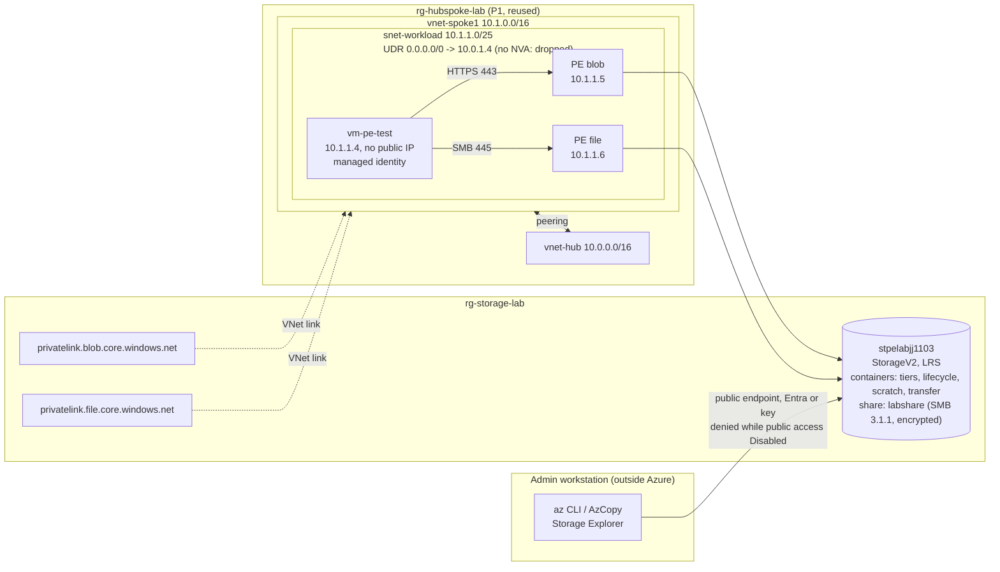
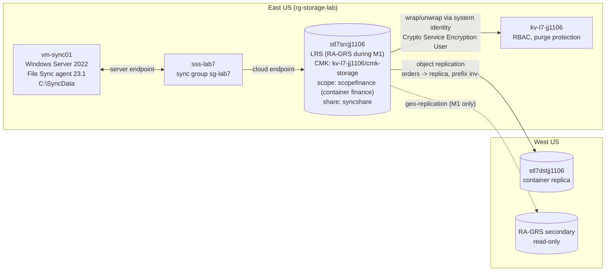

# Azure Storage + Private Endpoints Lab

Hands-on lab covering what an Azure administrator owns in **Azure Storage**: access tiers, rehydration and lifecycle rules; data protection; SAS vs. RBAC data access; Azure Files; AzCopy and Storage Explorer; and **private endpoints with private DNS** on an existing hub-and-spoke network ([azure-hub-spoke-network](https://github.com/ChefBoyRJeff/azure-hub-spoke-network)). It was built in the portal and CLI first, then codified in Bicep and verified against the live account with what-if. The planned failures are documented from real evidence.

**Lab 7 (storage extras)** extends it with redundancy changes, object replication, encryption scopes, a customer-managed key in Key Vault, and Azure File Sync to a Windows Server VM. See [Lab 7](#lab-7-storage-extras).

Built as a hands-on project while studying for **AZ-104: Microsoft Azure Administrator**. This is lab work in a personal subscription, not a production environment.

> **Status:** complete (M0-M6, then Lab 7 M0-M5). All lab resources torn down; see [Cleanup](#cleanup).

## Business problem

A team keeps files in Azure Storage but hands out account keys, leaves data reachable from the internet, and doesn't know which access tier or retention it needs. This lab builds the storage controls an administrator owns, breaks them on purpose, and records how each failure was diagnosed and fixed.

## Architecture



The VM, private endpoints and zones existed only during M4; the Bicep template can rebuild the private endpoint part with `deployPrivateEndpoints = true`.

## What was built and what it showed

| Milestone | Built | Key verified result |
|---|---|---|
| M0 | Scaffold, P1 inspection, $5 budget, prices | P1 route `0.0.0.0/0 -> 10.0.1.4` with no appliance; lab estimate under $1 |
| M1 | Blob tiers, rehydration, versioning, soft delete, lifecycle | Archive read -> `BlobArchived` (409); High-priority rehydration **about 44 min**; overwrite and delete recovered by promoting versions; lifecycle moved a blob to Cool **about 16 h** after the rule was applied |
| M2 | Keys, SAS, RBAC data roles, shared key off | Owner denied blob data with Entra (no `dataActions`); container-scoped Reader worked after **about 1.1 min**; user delegation SAS capped by RBAC (403 on write); stored access policy revoked only its own tokens; disabling shared key **suspends** key-signed SAS, rotation **revokes** it (about 15 s) |
| M3 | Azure Files share, snapshot, restore | TCP 445 blocked from home (443 OK) -> mount moved into Azure; **RCA-001** unplanned backup vault and lock; file restore from snapshot via portal and CLI |
| M4 | VM in P1 spoke, blob + file private endpoints, private DNS, public access off | Baseline **timeout** -> after PE **403** -> after VM identity role **200**; **RCA-002** unlinked zone; workstation refused with valid key and RBAC; SMB 3.1.1 encrypted mount over PE |
| M5 | AzCopy + Storage Explorer | AzCopy reused the az login token; Reader upload 403 (job Cancelled); container-scoped Contributor in **0.6 min**; S2S copy; `sync --delete-destination` dry run; **Storage Explorer wrote to a Reader-only container using the account key** |
| M6 | Bicep, what-if, docs, teardown | Template written from the live export; what-if found real drift (share soft delete off), fixed by deploy; final what-if: only documented noise |

## Lab 7: storage extras

Built on 2026-11-06 in a fresh `rg-storage-lab` with two new accounts. Evidence: `docs/evidence/lab7-00` to `lab7-06`.



| Milestone | Built | Key verified result |
|---|---|---|
| M1 Redundancy | LRS -> RA-GRS -> LRS | The `-secondary` hostname didn't resolve until about **29 min** after the change (status `Bootstrap`). Secondary read matched the primary's SHA-256. Secondary write **403** `InsufficientAccountPermissions`. A new blob reached the secondary in **17 s** while `lastSyncTime` stayed older, so it's a lower bound for data loss, not "latest data". Back on LRS, the secondary disappeared at once. |
| M2 Object replication | Policy `orders -> replica`, prefix `inv-`, East US -> West US | Without versioning: `RequiredFeatureDisabled`. Copy after **158 s**, overwrite after **33 s**, non-matching blob never copied. **Deletes are replicated** (my prediction was wrong). Recovery came from a source previous version, back on the destination after **95 s**. Destination writes rejected by policy; the destination assigns its own version IDs. |
| M3a Encryption scope | `scopefinance` (infrastructure encryption) as the `finance` container default, override denied | Override upload rejected. Disabling blocked reads only after **about 12 min**, with **409** `EncryptionScopeNotAvailable` (docs say 403). Re-enabled in under a minute, then flapped for about 30 min. Billed $1/month with a 30-day minimum. |
| M3b Customer-managed key | Key Vault (RBAC, purge protection), RSA 2048 key, account system identity | Planned failure `KeyVaultAuthenticationFailure` before the vault role. Existing data stayed readable after the switch (only the wrapping key changes). Key disabled: **403** `KeyVaultEncryptionKeyNotFound` after **171 s**, while the account still showed `Succeeded`. Data under a scope's own key stayed readable. Recovery took **567 s**. |
| M4 Azure File Sync | Sync service, sync group, cloud endpoint, `vm-sync01` server endpoint | Agent installed with Run Command and registered with the VM's **managed identity** (no RDP). Server -> cloud within about 35 s. A file uploaded straight to the share was **still absent after 612 s**, then arrived **92 s** after `triggerChangeDetection`. **RCA-003**: backup auto-enabled again. |
| M5 Bicep + teardown | `infra/lab7/storage-extras.bicep` from the live export | What-if run 1 found real drift (sync service `useIdentity`, key rotation policy) and a hazard: redeploying the share would erase File Sync's metadata and stored access policy. Run 2: documented noise only. **RCA-004**: the server endpoint delete aborted because the server was off. |

Deploy (from an empty resource group, two passes because the storage identity must hold the Key Vault role before CMK can be turned on):

```powershell
Copy-Item infra/lab7/storage-extras.example.bicepparam infra/lab7/storage-extras.local.bicepparam   # gitignored; fill in names
az deployment group what-if -g rg-storage-lab -f infra/lab7/storage-extras.bicep -p infra/lab7/storage-extras.local.bicepparam
az deployment group create  -g rg-storage-lab -f infra/lab7/storage-extras.bicep -p infra/lab7/storage-extras.local.bicepparam                   # pass 1: useCmk = false
az deployment group create  -g rg-storage-lab -f infra/lab7/storage-extras.bicep -p infra/lab7/storage-extras.local.bicepparam useCmk=true     # pass 2
```

The template doesn't deploy the File Sync server side (VM, agent, registered server, server endpoint) or the roles the portal granted the sync service on the account. Set `deployShare = false` once File Sync owns the share. The full Lab 7 run is in `docs/plan.md`.

## Troubleshooting and root-cause reports

| Report | Symptom | Root cause |
|---|---|---|
| [RCA-001](docs/rca/rca-001-unplanned-backup-vault.md) | Recovery Services vault and `CanNotDelete` lock appeared after creating a file share | The share wizard enables Azure Backup by default |
| [RCA-002](docs/rca/rca-002-private-dns-zone-not-linked.md) | Private endpoint healthy, but the VM resolved the public IP and timed out | Private DNS zone had no VNet link to the client VNet (planned failure) |
| [RCA-003](docs/rca/rca-003-backup-auto-enabled-again.md) | Lab 7: vault and `CanNotDelete` lock appeared again after creating the File Sync share | Same wizard default as RCA-001. A reminder isn't a control; the scripted inventory caught it again |
| [RCA-004](docs/rca/rca-004-server-endpoint-delete-offline-server.md) | Lab 7 teardown: server endpoint DELETE accepted, but the resource stayed | Delete workflow `Aborted` at `deleteServerEndpointOnServer`: the VM was deallocated. Fixed by unregistering the server |

Other findings recorded in the evidence:
- The lifecycle rule saved `tierToCold` instead of Cool, and a portal edit didn't persist; it was fixed by applying `infra/lifecycle-policy.json`.
- Re-enabling `publicNetworkAccess` left `networkAcls.defaultAction = Deny`.
- An SMB write failed on a PowerShell 5.1 drive mapped to a UNC path (hypothesis; the script is fixed but not re-tested).
- Share soft delete was found disabled at M6 export (cause unconfirmed: never applied, or changed via the data plane).

## Repository structure

```
infra/
  main.bicep                  storage account, services, containers, share, lifecycle, optional PEs
  main.bicepparam             lab values (no IDs or secrets)
  modules/private-endpoint.bicep   PE + private DNS zone + VNet link + zone group
  lifecycle-policy.json       lifecycle rule (used by the CLI in M1e and loaded by Bicep)
  budget.bicep, budget.example.bicepparam   cost guardrail
  lab7/storage-extras.bicep   Lab 7: two accounts, object replication, encryption scope, Key Vault + CMK, File Sync (cloud side)
  lab7/modules/or-source-policy.bicep      source side of the replication policy (name known only at deploy time)
  lab7/storage-extras.example.bicepparam   parameter template (copy to *.local.bicepparam)
scripts/
  m4-probe.ps1                VM-side probe: DNS, TCP, managed-identity blob read (Run Command)
  m4-smb-mount.ps1            VM-side SMB mount test (key passed as a parameter, rotated after)
docs/
  plan.md                     plan, outcomes and deviations
  interview-guide.md          walkthrough, deep dive, Q&A
  evidence/                   sanitized command output for every milestone
  rca/                        root-cause reports
```

## Prerequisites

- An Azure subscription with Owner or Contributor + User Access Administrator on the lab resource group.
- Azure CLI 2.90 with Bicep 0.48 (`az bicep install`), PowerShell 7, AzCopy 10.22 or later, and Storage Explorer (both via winget).
- For private endpoints: the P1 network (`rg-hubspoke-lab`, `vnet-spoke1/snet-workload`, private endpoint network policies Disabled) in the same region.

## Deploy

```powershell
az group create -n rg-storage-lab -l eastus --tags project=azure-storage-private-endpoints-lab
# Optional cost guardrail (copy the example to budget.local.bicepparam and set your email; it is gitignored)
az deployment sub create -l eastus --template-file infra/budget.bicep --parameters infra/budget.local.bicepparam

az deployment group what-if -g rg-storage-lab --template-file infra/main.bicep --parameters infra/main.bicepparam
az deployment group create  -g rg-storage-lab --template-file infra/main.bicep --parameters infra/main.bicepparam

# M4 design (billed hourly): blob + file private endpoints, zones and links
az deployment group what-if -g rg-storage-lab --template-file infra/main.bicep --parameters infra/main.bicepparam --parameters deployPrivateEndpoints=true
```

`storageAccountName` must be globally unique, so change it in `main.bicepparam`. Data roles are not in the template. Grant them at the narrowest scope, for example Storage Blob Data Reader on one container.

## Verification

- `az deployment group what-if` after deployment shows only the known `staticWebsite` noise (see `docs/evidence/m6-01-bicep-whatif.txt`).
- `scripts/m4-probe.ps1` via `az vm run-command invoke` checks DNS (private IP and privatelink CNAME), TCP 443/445, and a managed-identity blob read.

## Security notes

- Anonymous blob access is off, TLS 1.2 is the minimum, HTTPS only, copy scope is the same tenant, and cross-tenant replication is off.
- Data access uses Entra RBAC at container scope. Shared key stayed enabled only because M3 used key-based SMB; **M5 showed why that matters**: an Owner can fetch keys, and any key-capable tool bypasses RBAC. Production setting: `allowSharedKeyAccess = false`, with identity-based SMB auth.
- No keys or SAS values are in the repo. Keys used during tests were rotated, and the evidence was scanned for key-like strings.

## Cost

**Lab 7:** about $1.10-1.20 estimated, mostly the encryption scope ($1 per scope per month, minimum 30 days, which wasn't in the original cost plan). Other Lab 7 items: B2s Windows VM about 1 h running at $0.0496/h plus its disk; RA-GRS for about 1 h; Key Vault operations. Azure File Sync had no meter in the price lookup, so it's not estimated; check actual billing.

**M0-M6:** estimate under $1 (`docs/plan.md`): storage pennies; M4 VM about 45 min at $0.0496/h; 2 private endpoints at $0.01/h; 2 private DNS zones at up to $0.50 each (proration not confirmed). Actual charges are checked against the budget after billing posts.

## Cleanup

Done at the end of M6 (`docs/evidence/m6-02-teardown.txt`): remove the data role assignments, delete the storage account and `rg-storage-lab`, and confirm no lab resources remain. The budget is deleted later, after the last charges post. P1's network was left unchanged throughout.

Lab 7 (`docs/evidence/lab7-06-teardown.txt`): File Sync removed in order (server unregistered in the portal per RCA-004, cloud endpoint, sync group), then `rg-storage-lab` deleted. Subscription-wide check: 0 sync services, 0 `stl7*` accounts, 0 Recovery Services vaults, 0 VM disks. `kv-l7-jj1106` is soft-deleted with purge protection until 2026-11-13: no charge, and the name stays reserved.

## Limitations and possible improvements

- The SMB **write** over the private endpoint was not verified (read, list and snapshot read were).
- Role assignments and data were created by hand, not in code.
- Shared key stayed enabled for the lab; production would disable it and use Entra Kerberos for Azure Files.
- Centralized private DNS (zones linked to hub and every spoke) and Azure DNS Private Resolver for on-premises clients were described, not built.
- Service endpoints were covered conceptually; adding one would have required changing P1's Bicep.
- Lab 7: geo **failover** wasn't run (status stayed `Bootstrap`, `canFailover` false). The LRS -> ZRS conversion wasn't tested (the portal didn't offer ZRS while the account was RA-GRS). The CMK used the account's system identity; a user-assigned identity would allow CMK on the first deployment. Cloud tiering was off, because the endpoint was on the system volume.
- Lab 7 Bicep was compared with what-if, not deployed from scratch, so the two-pass CMK order is designed but untested.

## Skills demonstrated (AZ-104)

Configure storage accounts, redundancy (LRS/RA-GRS conversion, secondary read access) and access tiers; object replication; encryption scopes and customer-managed keys in Key Vault; Azure File Sync; lifecycle management; blob versioning and soft delete; SAS, stored access policies and access keys; RBAC data roles and least privilege; storage firewall and private endpoints; private DNS; Azure Files and snapshots; AzCopy and Storage Explorer; Bicep and what-if.
